<a href="https://kich.dev.br"></a>

<p align="center"><b>English</b> · <a href="https://github.com/tavmata/tavmata/blob/main/README.pt-BR.md">Português</a></p>

I study International Relations at the Federal University of Santa Catarina (UFSC), in Florianópolis, and research migration and international law. I also build games, data dashboards and AI workflows. I don't come from computer science: I built most of what's below by directing coding agents.

<p align="center">
<a href="https://mmorpg.kich.dev.br"><b>Play Kapi Online</b></a> ·
<a href="https://tavmata.github.io/painel-sul-sul-sismigra/">Migration dashboard</a> ·
<a href="https://kich.dev.br">kich.dev.br</a> ·
<a href="https://otaviokmkm.itch.io">itch.io</a> ·
<a href="https://www.linkedin.com/in/ot%C3%A1vio-kich-mata-70b78b212/">LinkedIn</a> ·
<a href="https://lattes.cnpq.br/4797477996223695">Lattes</a>
</p>

## Tonight's lineup

This page follows [my site](https://kich.dev.br): every section is a TV channel drawn in its own style. Open one to tune in.

<details open>
<summary><code>CH 02</code> Kapi Online · the MMORPG I make with coding agents</summary>
<br>

<a href="https://mmorpg.kich.dev.br">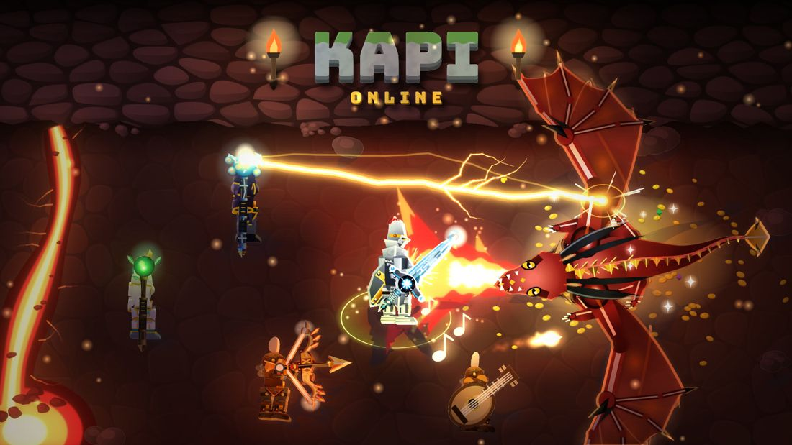</a>

<table>
<tr>
<td width="33%"><a href="https://mmorpg.kich.dev.br">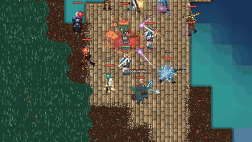</a></td>
<td width="33%"><a href="https://mmorpg.kich.dev.br"></a></td>
<td width="33%"><a href="https://mmorpg.kich.dev.br">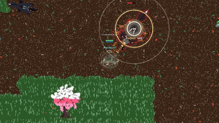</a></td>
</tr>
<tr>
<td align="center"><sub>Raid</sub></td>
<td align="center"><sub>Void Dimension</sub></td>
<td align="center"><sub>The bard's Final Chord</sub></td>
</tr>
</table>

Kapi Online is a 2D MMORPG made for playing in a group: five classes, boss dungeons, guilds and a market between players. A statue turns real study time into progress in the game, and an AI reads what you studied and answers with a tip and a next step, the way a teacher would. The art is drawn in code.

- A Node.js server decides every action, 30 times a second, and is built to handle 1,000 players.
- The 2D client runs on desktop and phone. There is also a playable 3D version in Godot.
- The repository got 2,630 commits between 28 July and 25 November 2026: 922 mine, 865 from AI agents and 843 automatic ones from GitHub Actions.

It opens in the browser, with nothing to install: [mmorpg.kich.dev.br](https://mmorpg.kich.dev.br)

<sub><a href="https://kich.dev.br/#kapi">CH 02 on kich.dev.br</a></sub>
</details>

<details>
<summary><code>CH 03</code> Clock · who writes Kapi Online, hour by hour</summary>
<br>


The blue towers are Jules and the other coding agents.

<sub><a href="https://kich.dev.br/#relogio">CH 03 on kich.dev.br</a></sub>
</details>

<details>
<summary><code>CH 04</code> Research · migration, human rights and international law</summary>
<br>

I research public international law, migration policy, human rights and Latin American constitutionalism.

My current project looks at immigration from Asia and Africa to Brazil in the SISMIGRA microdata: who arrives from the Global South, under which legal basis, and how they enter the labor market. The map shows the ten largest origins in each region. Click a marker or a line for the numbers.

```geojson
{"type":"FeatureCollection","features":[{"type":"Feature","geometry":{"type":"LineString","coordinates":[[116.4,39.9],[-47.88,-15.79]]},"properties":{"from":"China","records":"64,990","stroke":"#e6007e","stroke-width":8.0,"stroke-opacity":0.45}},{"type":"Feature","geometry":{"type":"LineString","coordinates":[[120.98,14.6],[-47.88,-15.79]]},"properties":{"from":"Philippines","records":"26,271","stroke":"#e6007e","stroke-width":3.8,"stroke-opacity":0.45}},{"type":"Feature","geometry":{"type":"LineString","coordinates":[[77.21,28.61],[-47.88,-15.79]]},"properties":{"from":"India","records":"22,670","stroke":"#e6007e","stroke-width":3.4,"stroke-opacity":0.45}},{"type":"Feature","geometry":{"type":"LineString","coordinates":[[126.98,37.57],[-47.88,-15.79]]},"properties":{"from":"South Korea","records":"17,300","stroke":"#e6007e","stroke-width":2.9,"stroke-opacity":0.45}},{"type":"Feature","geometry":{"type":"LineString","coordinates":[[36.29,33.51],[-47.88,-15.79]]},"properties":{"from":"Syria","records":"8,984","stroke":"#e6007e","stroke-width":2.0,"stroke-opacity":0.45}},{"type":"Feature","geometry":{"type":"LineString","coordinates":[[90.41,23.81],[-47.88,-15.79]]},"properties":{"from":"Bangladesh","records":"7,797","stroke":"#e6007e","stroke-width":1.8,"stroke-opacity":0.45}},{"type":"Feature","geometry":{"type":"LineString","coordinates":[[69.21,34.56],[-47.88,-15.79]]},"properties":{"from":"Afghanistan","records":"7,627","stroke":"#e6007e","stroke-width":1.8,"stroke-opacity":0.45}},{"type":"Feature","geometry":{"type":"LineString","coordinates":[[35.5,33.89],[-47.88,-15.79]]},"properties":{"from":"Lebanon","records":"6,973","stroke":"#e6007e","stroke-width":1.8,"stroke-opacity":0.45}},{"type":"Feature","geometry":{"type":"LineString","coordinates":[[106.85,-6.21],[-47.88,-15.79]]},"properties":{"from":"Indonesia","records":"6,476","stroke":"#e6007e","stroke-width":1.7,"stroke-opacity":0.45}},{"type":"Feature","geometry":{"type":"LineString","coordinates":[[32.86,39.93],[-47.88,-15.79]]},"properties":{"from":"Turkey","records":"3,385","stroke":"#e6007e","stroke-width":1.4,"stroke-opacity":0.45}},{"type":"Feature","geometry":{"type":"LineString","coordinates":[[13.23,-8.84],[-47.88,-15.79]]},"properties":{"from":"Angola","records":"33,029","stroke":"#0078bf","stroke-width":4.6,"stroke-opacity":0.45}},{"type":"Feature","geometry":{"type":"LineString","coordinates":[[-17.47,14.72],[-47.88,-15.79]]},"properties":{"from":"Senegal","records":"10,967","stroke":"#0078bf","stroke-width":2.2,"stroke-opacity":0.45}},{"type":"Feature","geometry":{"type":"LineString","coordinates":[[7.4,9.08],[-47.88,-15.79]]},"properties":{"from":"Nigeria","records":"8,264","stroke":"#0078bf","stroke-width":1.9,"stroke-opacity":0.45}},{"type":"Feature","geometry":{"type":"LineString","coordinates":[[-15.6,11.86],[-47.88,-15.79]]},"properties":{"from":"Guinea-Bissau","records":"7,379","stroke":"#0078bf","stroke-width":1.8,"stroke-opacity":0.45}},{"type":"Feature","geometry":{"type":"LineString","coordinates":[[32.57,-25.97],[-47.88,-15.79]]},"properties":{"from":"Mozambique","records":"6,025","stroke":"#0078bf","stroke-width":1.6,"stroke-opacity":0.45}},{"type":"Feature","geometry":{"type":"LineString","coordinates":[[-6.83,34.02],[-47.88,-15.79]]},"properties":{"from":"Morocco","records":"4,821","stroke":"#0078bf","stroke-width":1.5,"stroke-opacity":0.45}},{"type":"Feature","geometry":{"type":"LineString","coordinates":[[-0.19,5.6],[-47.88,-15.79]]},"properties":{"from":"Ghana","records":"4,140","stroke":"#0078bf","stroke-width":1.4,"stroke-opacity":0.45}},{"type":"Feature","geometry":{"type":"LineString","coordinates":[[31.24,30.04],[-47.88,-15.79]]},"properties":{"from":"Egypt","records":"3,474","stroke":"#0078bf","stroke-width":1.4,"stroke-opacity":0.45}},{"type":"Feature","geometry":{"type":"LineString","coordinates":[[-23.51,14.93],[-47.88,-15.79]]},"properties":{"from":"Cape Verde","records":"3,143","stroke":"#0078bf","stroke-width":1.3,"stroke-opacity":0.45}},{"type":"Feature","geometry":{"type":"LineString","coordinates":[[15.27,-4.44],[-47.88,-15.79]]},"properties":{"from":"DR Congo","records":"2,780","stroke":"#0078bf","stroke-width":1.3,"stroke-opacity":0.45}},{"type":"Feature","geometry":{"type":"Point","coordinates":[116.4,39.9]},"properties":{"country":"China","region":"Asia","records":"64,990","work or investment basis":"42.9%","humanitarian or refugee basis":"4.7%","marker-color":"#e6007e","marker-size":"large"}},{"type":"Feature","geometry":{"type":"Point","coordinates":[120.98,14.6]},"properties":{"country":"Philippines","region":"Asia","records":"26,271","work or investment basis":"93.6%","humanitarian or refugee basis":"1.5%","marker-color":"#e6007e","marker-size":"large"}},{"type":"Feature","geometry":{"type":"Point","coordinates":[77.21,28.61]},"properties":{"country":"India","region":"Asia","records":"22,670","work or investment basis":"81.9%","humanitarian or refugee basis":"2.2%","marker-color":"#e6007e","marker-size":"large"}},{"type":"Feature","geometry":{"type":"Point","coordinates":[126.98,37.57]},"properties":{"country":"South Korea","region":"Asia","records":"17,300","work or investment basis":"58.9%","humanitarian or refugee basis":"1.0%","marker-color":"#e6007e","marker-size":"medium"}},{"type":"Feature","geometry":{"type":"Point","coordinates":[36.29,33.51]},"properties":{"country":"Syria","region":"Asia","records":"8,984","work or investment basis":"0.7%","humanitarian or refugee basis":"49.1%","marker-color":"#e6007e","marker-size":"medium"}},{"type":"Feature","geometry":{"type":"Point","coordinates":[90.41,23.81]},"properties":{"country":"Bangladesh","region":"Asia","records":"7,797","work or investment basis":"23.9%","humanitarian or refugee basis":"19.2%","marker-color":"#e6007e","marker-size":"medium"}},{"type":"Feature","geometry":{"type":"Point","coordinates":[69.21,34.56]},"properties":{"country":"Afghanistan","region":"Asia","records":"7,627","work or investment basis":"0.2%","humanitarian or refugee basis":"97.8%","marker-color":"#e6007e","marker-size":"medium"}},{"type":"Feature","geometry":{"type":"Point","coordinates":[35.5,33.89]},"properties":{"country":"Lebanon","region":"Asia","records":"6,973","work or investment basis":"3.3%","humanitarian or refugee basis":"25.2%","marker-color":"#e6007e","marker-size":"medium"}},{"type":"Feature","geometry":{"type":"Point","coordinates":[106.85,-6.21]},"properties":{"country":"Indonesia","region":"Asia","records":"6,476","work or investment basis":"92.6%","humanitarian or refugee basis":"0.3%","marker-color":"#e6007e","marker-size":"medium"}},{"type":"Feature","geometry":{"type":"Point","coordinates":[32.86,39.93]},"properties":{"country":"Turkey","region":"Asia","records":"3,385","work or investment basis":"32.9%","humanitarian or refugee basis":"7.1%","marker-color":"#e6007e","marker-size":"small"}},{"type":"Feature","geometry":{"type":"Point","coordinates":[13.23,-8.84]},"properties":{"country":"Angola","region":"Africa","records":"33,029","work or investment basis":"1.6%","humanitarian or refugee basis":"49.4%","marker-color":"#0078bf","marker-size":"large"}},{"type":"Feature","geometry":{"type":"Point","coordinates":[-17.47,14.72]},"properties":{"country":"Senegal","region":"Africa","records":"10,967","work or investment basis":"8.4%","humanitarian or refugee basis":"5.5%","marker-color":"#0078bf","marker-size":"medium"}},{"type":"Feature","geometry":{"type":"Point","coordinates":[7.4,9.08]},"properties":{"country":"Nigeria","region":"Africa","records":"8,264","work or investment basis":"5.1%","humanitarian or refugee basis":"21.2%","marker-color":"#0078bf","marker-size":"medium"}},{"type":"Feature","geometry":{"type":"Point","coordinates":[-15.6,11.86]},"properties":{"country":"Guinea-Bissau","region":"Africa","records":"7,379","work or investment basis":"2.3%","humanitarian or refugee basis":"13.7%","marker-color":"#0078bf","marker-size":"medium"}},{"type":"Feature","geometry":{"type":"Point","coordinates":[32.57,-25.97]},"properties":{"country":"Mozambique","region":"Africa","records":"6,025","work or investment basis":"9.5%","humanitarian or refugee basis":"6.7%","marker-color":"#0078bf","marker-size":"medium"}},{"type":"Feature","geometry":{"type":"Point","coordinates":[-6.83,34.02]},"properties":{"country":"Morocco","region":"Africa","records":"4,821","work or investment basis":"4.0%","humanitarian or refugee basis":"54.3%","marker-color":"#0078bf","marker-size":"small"}},{"type":"Feature","geometry":{"type":"Point","coordinates":[-0.19,5.6]},"properties":{"country":"Ghana","region":"Africa","records":"4,140","work or investment basis":"5.1%","humanitarian or refugee basis":"40.0%","marker-color":"#0078bf","marker-size":"small"}},{"type":"Feature","geometry":{"type":"Point","coordinates":[31.24,30.04]},"properties":{"country":"Egypt","region":"Africa","records":"3,474","work or investment basis":"13.3%","humanitarian or refugee basis":"15.6%","marker-color":"#0078bf","marker-size":"small"}},{"type":"Feature","geometry":{"type":"Point","coordinates":[-23.51,14.93]},"properties":{"country":"Cape Verde","region":"Africa","records":"3,143","work or investment basis":"2.6%","humanitarian or refugee basis":"4.4%","marker-color":"#0078bf","marker-size":"small"}},{"type":"Feature","geometry":{"type":"Point","coordinates":[15.27,-4.44]},"properties":{"country":"DR Congo","region":"Africa","records":"2,780","work or investment basis":"1.5%","humanitarian or refugee basis":"54.2%","marker-color":"#0078bf","marker-size":"small"}},{"type":"Feature","geometry":{"type":"Point","coordinates":[-47.88,-15.79]},"properties":{"name":"Brazil","marker-color":"#f5b700","marker-size":"large","marker-symbol":"star"}}]}
```

<sub>Counts are registrations from 2010 to April 2026, not unique people. Global South as defined by UN DESA. <a href="https://github.com/tavmata/tavmata/blob/main/assets/map-en.geojson">Open the map full screen</a>.</sub>

- Two published articles (Qualis B3+) on financial education and decision-making, and one under review. I co-wrote books too, among them *Diálogos Impertinentes na Pandemia* (2022).
- Three undergraduate research grants (PIBIC and EIRENÈ) on Latin American constitutionalism and international law, with papers presented at ADM 2024, BELS 2024 and V SEPERI.
- A project proposal of mine was accepted for pre-incubation at Sapiens Parque, in Florianópolis.

More in my [Lattes CV](https://lattes.cnpq.br/4797477996223695), Brazil's academic registry.

<sub><a href="https://kich.dev.br/#pesquisa">CH 04 on kich.dev.br</a></sub>
</details>

<details>
<summary><code>CH 05</code> Passport · migrants, refugees and the UN</summary>
<br>


- Federal Public Defender's Office (DPU), Migration Unit, Florianópolis, December 2024 to September 2025. I assisted migrants, refugees and asylum seekers in English, Spanish and French. I drafted petitions, administrative requests and regularization reports, and followed cases with federal agencies, consulates and reception services.
- United Nations Volunteers, UNRISD, June to December 2024, remote. Research and community engagement tied to the Sustainable Development Goals, with regional policy analysis for the UN Research Institute for Social Development.
- UFSCMUN VII and VIII. I organized two editions of the UFSC Model UN and co-wrote the study guides and the rules.
- Certificates in BSAFE field security (UNDSS), from the AUGM Winter School on Latin American Democracy (UFABC) and in Immigrant Rights (ENAP).

I speak Portuguese, English (C2), Spanish, French (B2) and some German and Mandarin.

<sub><a href="https://kich.dev.br/#passaporte">CH 05 on kich.dev.br</a></sub>
</details>

<details>
<summary><code>CH 06</code> Dashboard · South-South migration in Brazil, in Power BI</summary>
<br>

<table>
<tr>
<td width="50%"><a href="https://tavmata.github.io/painel-sul-sul-sismigra/">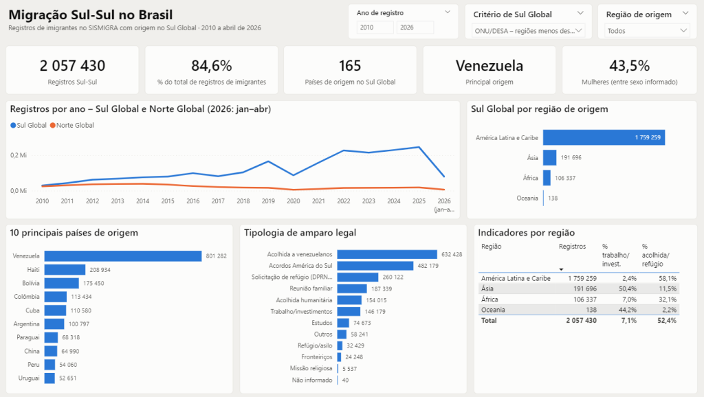</a></td>
<td width="50%"><a href="https://tavmata.github.io/painel-sul-sul-sismigra/">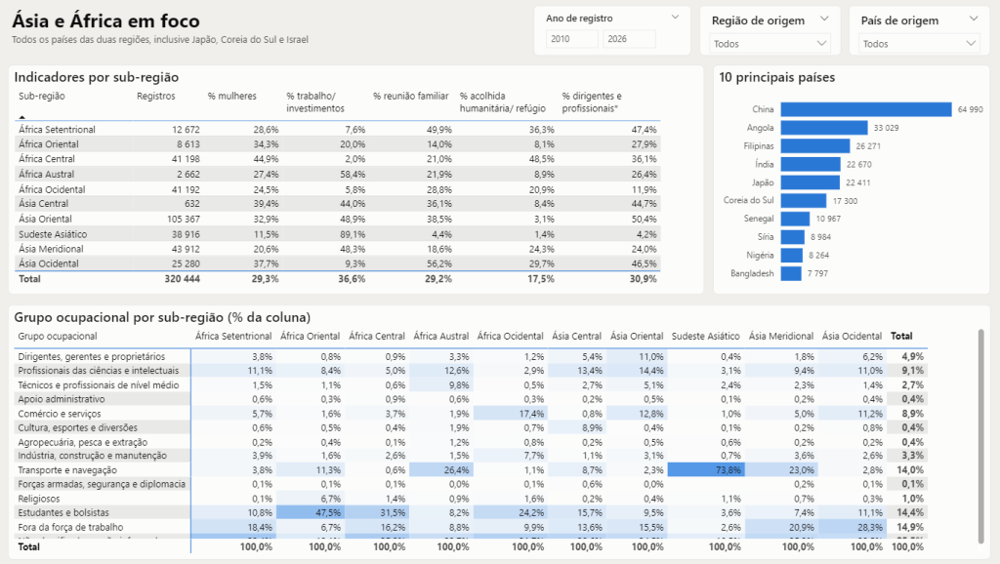</a></td>
</tr>
<tr>
<td align="center"><sub>Overview</sub></td>
<td align="center"><sub>Asia and Africa</sub></td>
</tr>
</table>

Records of immigrants from the Global South in Brazil, from 2010 to April 2026, with a focus on Asia and Africa. One selector switches the Global South definition (UN DESA or UNCTAD) across every measure. Of 2.43 million immigrant records in the period, 2,057,430 come from the Global South, and Venezuela alone accounts for 39% of those.

A Python script writes the whole Power BI file, with its tables, relationships, DAX measures and pages, so when new data arrives I rebuild the dashboard with one command.

[Open the web version](https://tavmata.github.io/painel-sul-sul-sismigra/), which has the same pages and filters · [Code and data](https://github.com/tavmata/painel-sul-sul-sismigra)

<sub><a href="https://kich.dev.br/#painel">CH 06 on kich.dev.br</a></sub>
</details>

<details>
<summary><code>CH 07</code> Agents · how I work with AI</summary>
<br>

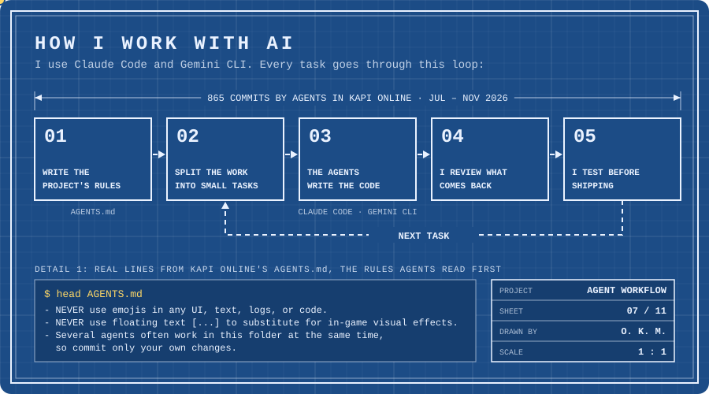

Several agent sessions work at once in the same repository, each on its own task. In research I use the same setup to clean microdata, build dashboards from code and turn my readings into Anki decks.

<sub><a href="https://kich.dev.br/#agentes">CH 07 on kich.dev.br</a></sub>
</details>

<details>
<summary><code>CH 08</code> Arcade · two more games, free on itch.io</summary>
<br>

<table>
<tr>
<td width="38%" valign="top"><a href="https://otaviokmkm.itch.io/pinball-heroes">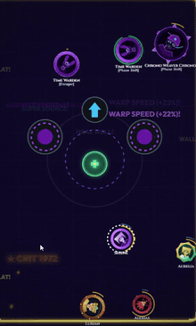</a></td>
<td width="62%" valign="top"><a href="https://otaviokmkm.itch.io/clair-tactics">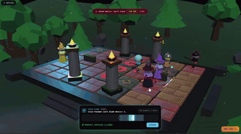</a>
<br><br>
<b><a href="https://otaviokmkm.itch.io/pinball-heroes">Pinball Heroes</a></b><br>
Pinball with RPG rules. You launch each hero into the board, and bumpers, portals and boosts change their speed and damage. The campaign has 30 stages.
<br><br>
<b><a href="https://otaviokmkm.itch.io/clair-tactics">Clair Tactics</a></b><br>
Turn-based tactics on a 3D board. You summon heroes, position the squad and time your strikes and parries.
<br><br>
Both run in the browser and save progress on your device.
</td>
</tr>
</table>

<sub><a href="https://kich.dev.br/#fliperama">CH 08 on kich.dev.br</a></sub>
</details>

<details>
<summary><code>CH 09</code> Character sheet · my CV as an RPG menu</summary>
<br>

<a href="https://kich.dev.br/#curriculo"></a>

The math olympiad is OBMEP, with honorable mentions in 2017 and 2019. I graduate in December 2027. The printable CV is on [kich.dev.br](https://kich.dev.br/#curriculo).

<sub><a href="https://kich.dev.br/#curriculo">CH 09 on kich.dev.br</a></sub>
</details>

<details>
<summary><code>CH 10</code> Cordel · the channel that went off the air</summary>
<br>

<table>
<tr>
<td width="40%" valign="top">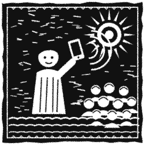</td>
<td valign="top">
I had a TikTok channel about political education that reached 5,000 followers, and I've since deleted it. The site keeps a footnote about it in cordel verse:
<br><br>
<i>Reader, spare me a minute<br>
and hear what I have to say:<br>
I ran a channel on TikTok<br>
explaining, in my own way,<br>
how government and politics work,<br>
with no frills and no display.</i>
<br><br>
<i>These days I am still researching<br>
and making games for you to play,<br>
but the channel left me something:<br>
the urge to explain, plain as day.<br>
If you would like another chapter,<br>
scroll down and say hey.</i>
</td>
</tr>
</table>

<sub><a href="https://kich.dev.br/#cordel">The whole cordel on kich.dev.br</a></sub>
</details>

<details>
<summary><code>CH 11</code> Contact · research, internships, or the games</summary>
<br>

<a href="https://kich.dev.br/#contato"></a>

<p align="center">
<a href="https://www.linkedin.com/in/ot%C3%A1vio-kich-mata-70b78b212/">LinkedIn</a> ·
<a href="https://lattes.cnpq.br/4797477996223695">Lattes</a> ·
<a href="https://otaviokmkm.itch.io">itch.io</a> ·
<a href="https://kich.dev.br/#contato">kich.dev.br</a>
</p>
</details>

<br>

<sub>The cards on this page are drawn in code, like the site: <a href="https://github.com/tavmata/tavmata/blob/main/tools/build.py">tools/build.py</a> makes the pixel room, the clock, the passport, the blueprint, the RPG menu and the test card. There is also a pinhão, the araucaria seed, hidden in the room at the top. It shows up for three seconds in every loop of the TV.</sub>
