<a href="https://kich.dev.br"></a>

<p align="center"><a href="https://github.com/tavmata">English</a> · <b>Português</b></p>

Estudo Relações Internacionais na Universidade Federal de Santa Catarina (UFSC), em Florianópolis, e pesquiso migração e direito internacional. Também construo jogos, painéis de dados e fluxos de trabalho com IA. Não venho da computação: quase tudo o que está aqui eu fiz coordenando agentes de código.

<p align="center">
<a href="https://mmorpg.kich.dev.br"><b>Jogar Kapi Online</b></a> ·
<a href="https://tavmata.github.io/painel-sul-sul-sismigra/">Painel de migração</a> ·
<a href="https://kich.dev.br">kich.dev.br</a> ·
<a href="https://otaviokmkm.itch.io">itch.io</a> ·
<a href="https://www.linkedin.com/in/ot%C3%A1vio-kich-mata-70b78b212/">LinkedIn</a> ·
<a href="https://lattes.cnpq.br/4797477996223695">Lattes</a>
</p>

## Programação de hoje

Esta página segue [o meu site](https://kich.dev.br): cada seção é um canal de TV desenhado num estilo diferente. Abra um para sintonizar.

<details open>
<summary><code>CH 02</code> Kapi Online · o MMORPG que faço com agentes de código</summary>
<br>

<a href="https://mmorpg.kich.dev.br">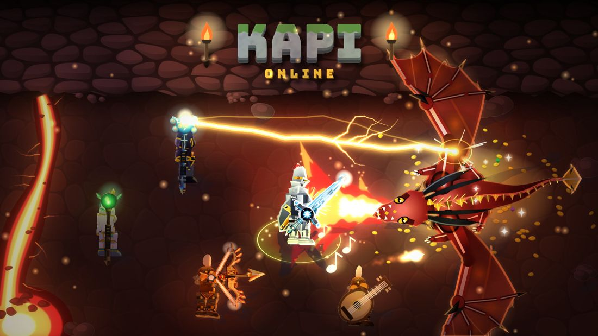</a>

<table>
<tr>
<td width="33%"><a href="https://mmorpg.kich.dev.br">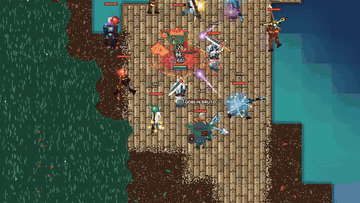</a></td>
<td width="33%"><a href="https://mmorpg.kich.dev.br">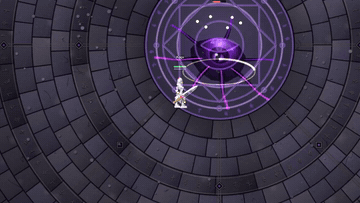</a></td>
<td width="33%"><a href="https://mmorpg.kich.dev.br">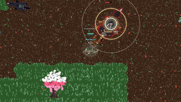</a></td>
</tr>
<tr>
<td align="center"><sub>Raid</sub></td>
<td align="center"><sub>Dimensão do Vazio</sub></td>
<td align="center"><sub>O Acorde Final do bardo</sub></td>
</tr>
</table>

O Kapi Online é um MMORPG em 2D feito para jogar em grupo: cinco classes, masmorras com chefes, guildas e um mercado entre jogadores. Uma estátua transforma tempo real de estudo em progresso no jogo, e uma IA lê o que você estudou e devolve uma dica e um próximo passo, como um professor faria. A arte é desenhada em código.

- Um servidor em Node.js decide cada ação, 30 vezes por segundo, e foi feito para aguentar 1.000 jogadores.
- O cliente 2D roda no computador e no celular. Também existe uma versão 3D jogável no Godot.
- O repositório recebeu 2.630 commits entre 28 de julho e 25 de novembro de 2026: 922 meus, 865 de agentes de IA e 843 automáticos do GitHub Actions.

Abre no navegador, sem instalar nada: [mmorpg.kich.dev.br](https://mmorpg.kich.dev.br)

<sub><a href="https://kich.dev.br/#kapi">CH 02 no kich.dev.br</a></sub>
</details>

<details>
<summary><code>CH 03</code> Relógio · quem escreve o Kapi Online, hora a hora</summary>
<br>


As torres azuis são o Jules e os outros agentes de código.

<sub><a href="https://kich.dev.br/#relogio">CH 03 no kich.dev.br</a></sub>
</details>

<details>
<summary><code>CH 04</code> Pesquisa · migração, direitos humanos e direito internacional</summary>
<br>

Pesquiso direito internacional público, políticas migratórias, direitos humanos e constitucionalismo latino-americano.

Meu projeto atual estuda a imigração da Ásia e da África para o Brasil nos microdados do SISMIGRA: quem chega do Sul Global, com qual amparo legal e como entra no mercado de trabalho. O mapa mostra as dez maiores origens de cada região. Clique num marcador ou numa linha para ver os números.

```geojson
{"type":"FeatureCollection","features":[{"type":"Feature","geometry":{"type":"LineString","coordinates":[[116.4,39.9],[-47.88,-15.79]]},"properties":{"de":"China","registros":"64.990","stroke":"#e6007e","stroke-width":8.0,"stroke-opacity":0.45}},{"type":"Feature","geometry":{"type":"LineString","coordinates":[[120.98,14.6],[-47.88,-15.79]]},"properties":{"de":"Filipinas","registros":"26.271","stroke":"#e6007e","stroke-width":3.8,"stroke-opacity":0.45}},{"type":"Feature","geometry":{"type":"LineString","coordinates":[[77.21,28.61],[-47.88,-15.79]]},"properties":{"de":"Índia","registros":"22.670","stroke":"#e6007e","stroke-width":3.4,"stroke-opacity":0.45}},{"type":"Feature","geometry":{"type":"LineString","coordinates":[[126.98,37.57],[-47.88,-15.79]]},"properties":{"de":"Coreia do Sul","registros":"17.300","stroke":"#e6007e","stroke-width":2.9,"stroke-opacity":0.45}},{"type":"Feature","geometry":{"type":"LineString","coordinates":[[36.29,33.51],[-47.88,-15.79]]},"properties":{"de":"Síria","registros":"8.984","stroke":"#e6007e","stroke-width":2.0,"stroke-opacity":0.45}},{"type":"Feature","geometry":{"type":"LineString","coordinates":[[90.41,23.81],[-47.88,-15.79]]},"properties":{"de":"Bangladesh","registros":"7.797","stroke":"#e6007e","stroke-width":1.8,"stroke-opacity":0.45}},{"type":"Feature","geometry":{"type":"LineString","coordinates":[[69.21,34.56],[-47.88,-15.79]]},"properties":{"de":"Afeganistão","registros":"7.627","stroke":"#e6007e","stroke-width":1.8,"stroke-opacity":0.45}},{"type":"Feature","geometry":{"type":"LineString","coordinates":[[35.5,33.89],[-47.88,-15.79]]},"properties":{"de":"Líbano","registros":"6.973","stroke":"#e6007e","stroke-width":1.8,"stroke-opacity":0.45}},{"type":"Feature","geometry":{"type":"LineString","coordinates":[[106.85,-6.21],[-47.88,-15.79]]},"properties":{"de":"Indonésia","registros":"6.476","stroke":"#e6007e","stroke-width":1.7,"stroke-opacity":0.45}},{"type":"Feature","geometry":{"type":"LineString","coordinates":[[32.86,39.93],[-47.88,-15.79]]},"properties":{"de":"Turquia","registros":"3.385","stroke":"#e6007e","stroke-width":1.4,"stroke-opacity":0.45}},{"type":"Feature","geometry":{"type":"LineString","coordinates":[[13.23,-8.84],[-47.88,-15.79]]},"properties":{"de":"Angola","registros":"33.029","stroke":"#0078bf","stroke-width":4.6,"stroke-opacity":0.45}},{"type":"Feature","geometry":{"type":"LineString","coordinates":[[-17.47,14.72],[-47.88,-15.79]]},"properties":{"de":"Senegal","registros":"10.967","stroke":"#0078bf","stroke-width":2.2,"stroke-opacity":0.45}},{"type":"Feature","geometry":{"type":"LineString","coordinates":[[7.4,9.08],[-47.88,-15.79]]},"properties":{"de":"Nigéria","registros":"8.264","stroke":"#0078bf","stroke-width":1.9,"stroke-opacity":0.45}},{"type":"Feature","geometry":{"type":"LineString","coordinates":[[-15.6,11.86],[-47.88,-15.79]]},"properties":{"de":"Guiné-Bissau","registros":"7.379","stroke":"#0078bf","stroke-width":1.8,"stroke-opacity":0.45}},{"type":"Feature","geometry":{"type":"LineString","coordinates":[[32.57,-25.97],[-47.88,-15.79]]},"properties":{"de":"Moçambique","registros":"6.025","stroke":"#0078bf","stroke-width":1.6,"stroke-opacity":0.45}},{"type":"Feature","geometry":{"type":"LineString","coordinates":[[-6.83,34.02],[-47.88,-15.79]]},"properties":{"de":"Marrocos","registros":"4.821","stroke":"#0078bf","stroke-width":1.5,"stroke-opacity":0.45}},{"type":"Feature","geometry":{"type":"LineString","coordinates":[[-0.19,5.6],[-47.88,-15.79]]},"properties":{"de":"Gana","registros":"4.140","stroke":"#0078bf","stroke-width":1.4,"stroke-opacity":0.45}},{"type":"Feature","geometry":{"type":"LineString","coordinates":[[31.24,30.04],[-47.88,-15.79]]},"properties":{"de":"Egito","registros":"3.474","stroke":"#0078bf","stroke-width":1.4,"stroke-opacity":0.45}},{"type":"Feature","geometry":{"type":"LineString","coordinates":[[-23.51,14.93],[-47.88,-15.79]]},"properties":{"de":"Cabo Verde","registros":"3.143","stroke":"#0078bf","stroke-width":1.3,"stroke-opacity":0.45}},{"type":"Feature","geometry":{"type":"LineString","coordinates":[[15.27,-4.44],[-47.88,-15.79]]},"properties":{"de":"RD Congo","registros":"2.780","stroke":"#0078bf","stroke-width":1.3,"stroke-opacity":0.45}},{"type":"Feature","geometry":{"type":"Point","coordinates":[116.4,39.9]},"properties":{"país":"China","região":"Ásia","registros":"64.990","amparo de trabalho ou investimentos":"42,9%","acolhida humanitária ou refúgio":"4,7%","marker-color":"#e6007e","marker-size":"large"}},{"type":"Feature","geometry":{"type":"Point","coordinates":[120.98,14.6]},"properties":{"país":"Filipinas","região":"Ásia","registros":"26.271","amparo de trabalho ou investimentos":"93,6%","acolhida humanitária ou refúgio":"1,5%","marker-color":"#e6007e","marker-size":"large"}},{"type":"Feature","geometry":{"type":"Point","coordinates":[77.21,28.61]},"properties":{"país":"Índia","região":"Ásia","registros":"22.670","amparo de trabalho ou investimentos":"81,9%","acolhida humanitária ou refúgio":"2,2%","marker-color":"#e6007e","marker-size":"large"}},{"type":"Feature","geometry":{"type":"Point","coordinates":[126.98,37.57]},"properties":{"país":"Coreia do Sul","região":"Ásia","registros":"17.300","amparo de trabalho ou investimentos":"58,9%","acolhida humanitária ou refúgio":"1,0%","marker-color":"#e6007e","marker-size":"medium"}},{"type":"Feature","geometry":{"type":"Point","coordinates":[36.29,33.51]},"properties":{"país":"Síria","região":"Ásia","registros":"8.984","amparo de trabalho ou investimentos":"0,7%","acolhida humanitária ou refúgio":"49,1%","marker-color":"#e6007e","marker-size":"medium"}},{"type":"Feature","geometry":{"type":"Point","coordinates":[90.41,23.81]},"properties":{"país":"Bangladesh","região":"Ásia","registros":"7.797","amparo de trabalho ou investimentos":"23,9%","acolhida humanitária ou refúgio":"19,2%","marker-color":"#e6007e","marker-size":"medium"}},{"type":"Feature","geometry":{"type":"Point","coordinates":[69.21,34.56]},"properties":{"país":"Afeganistão","região":"Ásia","registros":"7.627","amparo de trabalho ou investimentos":"0,2%","acolhida humanitária ou refúgio":"97,8%","marker-color":"#e6007e","marker-size":"medium"}},{"type":"Feature","geometry":{"type":"Point","coordinates":[35.5,33.89]},"properties":{"país":"Líbano","região":"Ásia","registros":"6.973","amparo de trabalho ou investimentos":"3,3%","acolhida humanitária ou refúgio":"25,2%","marker-color":"#e6007e","marker-size":"medium"}},{"type":"Feature","geometry":{"type":"Point","coordinates":[106.85,-6.21]},"properties":{"país":"Indonésia","região":"Ásia","registros":"6.476","amparo de trabalho ou investimentos":"92,6%","acolhida humanitária ou refúgio":"0,3%","marker-color":"#e6007e","marker-size":"medium"}},{"type":"Feature","geometry":{"type":"Point","coordinates":[32.86,39.93]},"properties":{"país":"Turquia","região":"Ásia","registros":"3.385","amparo de trabalho ou investimentos":"32,9%","acolhida humanitária ou refúgio":"7,1%","marker-color":"#e6007e","marker-size":"small"}},{"type":"Feature","geometry":{"type":"Point","coordinates":[13.23,-8.84]},"properties":{"país":"Angola","região":"África","registros":"33.029","amparo de trabalho ou investimentos":"1,6%","acolhida humanitária ou refúgio":"49,4%","marker-color":"#0078bf","marker-size":"large"}},{"type":"Feature","geometry":{"type":"Point","coordinates":[-17.47,14.72]},"properties":{"país":"Senegal","região":"África","registros":"10.967","amparo de trabalho ou investimentos":"8,4%","acolhida humanitária ou refúgio":"5,5%","marker-color":"#0078bf","marker-size":"medium"}},{"type":"Feature","geometry":{"type":"Point","coordinates":[7.4,9.08]},"properties":{"país":"Nigéria","região":"África","registros":"8.264","amparo de trabalho ou investimentos":"5,1%","acolhida humanitária ou refúgio":"21,2%","marker-color":"#0078bf","marker-size":"medium"}},{"type":"Feature","geometry":{"type":"Point","coordinates":[-15.6,11.86]},"properties":{"país":"Guiné-Bissau","região":"África","registros":"7.379","amparo de trabalho ou investimentos":"2,3%","acolhida humanitária ou refúgio":"13,7%","marker-color":"#0078bf","marker-size":"medium"}},{"type":"Feature","geometry":{"type":"Point","coordinates":[32.57,-25.97]},"properties":{"país":"Moçambique","região":"África","registros":"6.025","amparo de trabalho ou investimentos":"9,5%","acolhida humanitária ou refúgio":"6,7%","marker-color":"#0078bf","marker-size":"medium"}},{"type":"Feature","geometry":{"type":"Point","coordinates":[-6.83,34.02]},"properties":{"país":"Marrocos","região":"África","registros":"4.821","amparo de trabalho ou investimentos":"4,0%","acolhida humanitária ou refúgio":"54,3%","marker-color":"#0078bf","marker-size":"small"}},{"type":"Feature","geometry":{"type":"Point","coordinates":[-0.19,5.6]},"properties":{"país":"Gana","região":"África","registros":"4.140","amparo de trabalho ou investimentos":"5,1%","acolhida humanitária ou refúgio":"40,0%","marker-color":"#0078bf","marker-size":"small"}},{"type":"Feature","geometry":{"type":"Point","coordinates":[31.24,30.04]},"properties":{"país":"Egito","região":"África","registros":"3.474","amparo de trabalho ou investimentos":"13,3%","acolhida humanitária ou refúgio":"15,6%","marker-color":"#0078bf","marker-size":"small"}},{"type":"Feature","geometry":{"type":"Point","coordinates":[-23.51,14.93]},"properties":{"país":"Cabo Verde","região":"África","registros":"3.143","amparo de trabalho ou investimentos":"2,6%","acolhida humanitária ou refúgio":"4,4%","marker-color":"#0078bf","marker-size":"small"}},{"type":"Feature","geometry":{"type":"Point","coordinates":[15.27,-4.44]},"properties":{"país":"RD Congo","região":"África","registros":"2.780","amparo de trabalho ou investimentos":"1,5%","acolhida humanitária ou refúgio":"54,2%","marker-color":"#0078bf","marker-size":"small"}},{"type":"Feature","geometry":{"type":"Point","coordinates":[-47.88,-15.79]},"properties":{"name":"Brasil","marker-color":"#f5b700","marker-size":"large","marker-symbol":"star"}}]}
```

<sub>Os números contam registros de 2010 a abril de 2026, não pessoas únicas. Sul Global pelo critério da ONU/DESA. <a href="https://github.com/tavmata/tavmata/blob/main/assets/map-pt.geojson">Abrir o mapa em tela cheia</a>.</sub>

- Dois artigos publicados (Qualis B3+) sobre educação financeira e tomada de decisão, e um submetido. Também sou coautor de livros, entre eles *Diálogos Impertinentes na Pandemia* (2022).
- Três iniciações científicas (PIBIC e EIRENÈ) sobre constitucionalismo latino-americano e direito internacional, com trabalhos apresentados no ADM 2024, no BELS 2024 e no V SEPERI.
- Tive uma proposta de projeto aprovada para pré-incubação no Sapiens Parque, em Florianópolis.

Mais no meu [Currículo Lattes](https://lattes.cnpq.br/4797477996223695).

<sub><a href="https://kich.dev.br/#pesquisa">CH 04 no kich.dev.br</a></sub>
</details>

<details>
<summary><code>CH 05</code> Passaporte · migrantes, refugiados e a ONU</summary>
<br>


- Defensoria Pública da União (DPU), Núcleo de Migração, em Florianópolis, de dezembro de 2024 a setembro de 2025. Atendi migrantes, refugiados e solicitantes de refúgio em inglês, espanhol e francês. Redigi peças, requerimentos administrativos e relatórios de regularização migratória, e acompanhei processos com órgãos federais, consulados e serviços de acolhimento.
- Voluntários das Nações Unidas (UNV), no UNRISD, de junho a dezembro de 2024, de forma remota. Pesquisa e engajamento comunitário ligados aos Objetivos de Desenvolvimento Sustentável, com análise de políticas regionais para o Instituto de Pesquisa das Nações Unidas para o Desenvolvimento Social.
- UFSCMUN VII e VIII. Organizei duas edições da simulação da ONU da UFSC e escrevi os guias de estudo e as regras.
- Certificados de segurança em campo BSAFE (UNDSS), da Escola de Inverno AUGM sobre democracia latino-americana (UFABC) e de Direitos dos Imigrantes (ENAP).

Falo português, inglês (C2), espanhol, francês (B2) e o básico de alemão e mandarim.

<sub><a href="https://kich.dev.br/#passaporte">CH 05 no kich.dev.br</a></sub>
</details>

<details>
<summary><code>CH 06</code> Painel · migração Sul-Sul no Brasil, em Power BI</summary>
<br>

<table>
<tr>
<td width="50%"><a href="https://tavmata.github.io/painel-sul-sul-sismigra/">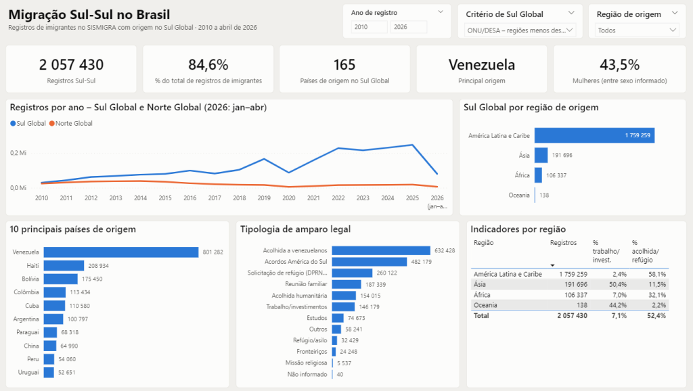</a></td>
<td width="50%"><a href="https://tavmata.github.io/painel-sul-sul-sismigra/">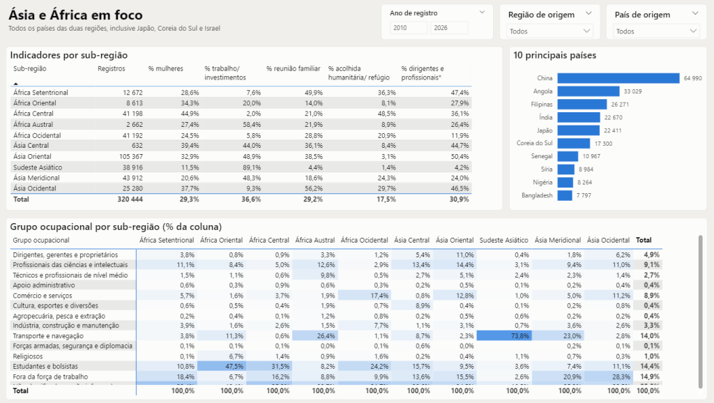</a></td>
</tr>
<tr>
<td align="center"><sub>Visão geral</sub></td>
<td align="center"><sub>Ásia e África</sub></td>
</tr>
</table>

Registros de imigrantes do Sul Global no Brasil, de 2010 a abril de 2026, com foco em Ásia e África. Um seletor troca o critério de Sul Global (ONU/DESA ou UNCTAD) em todas as medidas. Dos 2,43 milhões de registros de imigrantes no período, 2.057.430 vêm do Sul Global, e só a Venezuela responde por 39% deles.

Um script em Python gera o arquivo inteiro do Power BI, com tabelas, relações, medidas DAX e páginas. Quando chega dado novo, refaço o painel com um comando.

[Abrir a versão web](https://tavmata.github.io/painel-sul-sul-sismigra/), com as mesmas páginas e filtros · [Código e dados](https://github.com/tavmata/painel-sul-sul-sismigra)

<sub><a href="https://kich.dev.br/#painel">CH 06 no kich.dev.br</a></sub>
</details>

<details>
<summary><code>CH 07</code> Agentes · como trabalho com IA</summary>
<br>

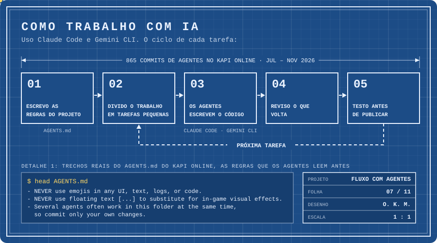

Várias sessões de agentes trabalham ao mesmo tempo no mesmo repositório, cada uma na sua tarefa. Na pesquisa uso o mesmo esquema para tratar microdados, montar painéis por código e transformar leituras em baralhos do Anki.

<sub><a href="https://kich.dev.br/#agentes">CH 07 no kich.dev.br</a></sub>
</details>

<details>
<summary><code>CH 08</code> Fliperama · mais dois jogos, grátis no itch.io</summary>
<br>

<table>
<tr>
<td width="38%" valign="top"><a href="https://otaviokmkm.itch.io/pinball-heroes">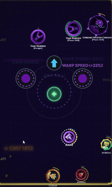</a></td>
<td width="62%" valign="top"><a href="https://otaviokmkm.itch.io/clair-tactics">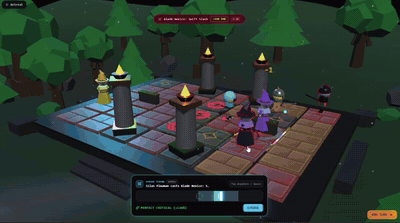</a>
<br><br>
<b><a href="https://otaviokmkm.itch.io/pinball-heroes">Pinball Heroes</a></b><br>
Pinball com RPG. Você lança cada herói na mesa, e bumpers, portais e impulsos mudam a velocidade e o dano. A campanha tem 30 fases.
<br><br>
<b><a href="https://otaviokmkm.itch.io/clair-tactics">Clair Tactics</a></b><br>
RPG tático por turnos num tabuleiro 3D. Você invoca heróis, posiciona o time e acerta o tempo dos golpes e das defesas.
<br><br>
Os dois rodam no navegador e salvam o progresso no seu aparelho.
</td>
</tr>
</table>

<sub><a href="https://kich.dev.br/#fliperama">CH 08 no kich.dev.br</a></sub>
</details>

<details>
<summary><code>CH 09</code> Ficha · o currículo como menu de RPG</summary>
<br>

<a href="https://kich.dev.br/#curriculo"></a>

As menções honrosas na OBMEP são de 2017 e 2019, e me formo em dezembro de 2027. O currículo para imprimir está no [kich.dev.br](https://kich.dev.br/#curriculo).

<sub><a href="https://kich.dev.br/#curriculo">CH 09 no kich.dev.br</a></sub>
</details>

<details>
<summary><code>CH 10</code> Cordel · o canal que saiu do ar</summary>
<br>

<table>
<tr>
<td width="40%" valign="top">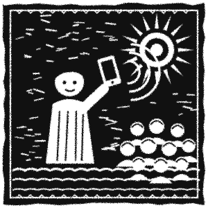</td>
<td valign="top">
Tive um canal no TikTok sobre educação política que chegou a 5.000 seguidores. Depois apaguei o canal. O site guarda uma nota de rodapé sobre isso, em versos:
<br><br>
<i>Peço licença ao leitor<br>
pra contar minha passagem<br>
por um canal no TikTok<br>
explicando a engrenagem<br>
do governo e da política,<br>
sem enfeite e sem bobagem.</i>
<br><br>
<i>Hoje eu sigo pesquisando,<br>
faço jogo pra rodar,<br>
mas do canal eu guardei<br>
o costume de explicar.<br>
Quem quiser mais um capítulo,<br>
é só descer e chamar.</i>
</td>
</tr>
</table>

<sub><a href="https://kich.dev.br/#cordel">O cordel inteiro no kich.dev.br</a></sub>
</details>

<details>
<summary><code>CH 11</code> Contato · pesquisa, estágio ou os jogos</summary>
<br>

<a href="https://kich.dev.br/#contato"></a>

<p align="center">
<a href="https://www.linkedin.com/in/ot%C3%A1vio-kich-mata-70b78b212/">LinkedIn</a> ·
<a href="https://lattes.cnpq.br/4797477996223695">Lattes</a> ·
<a href="https://otaviokmkm.itch.io">itch.io</a> ·
<a href="https://kich.dev.br/#contato">kich.dev.br</a>
</p>
</details>

<br>

<sub>Os cartões desta página são desenhados em código, como o site: o <a href="https://github.com/tavmata/tavmata/blob/main/tools/build.py">tools/build.py</a> faz a sala em pixel, o relógio, o passaporte, a planta, o menu de RPG e o padrão de teste. E tem um pinhão escondido na sala lá em cima. Ele aparece por três segundos a cada volta da TV.</sub>
